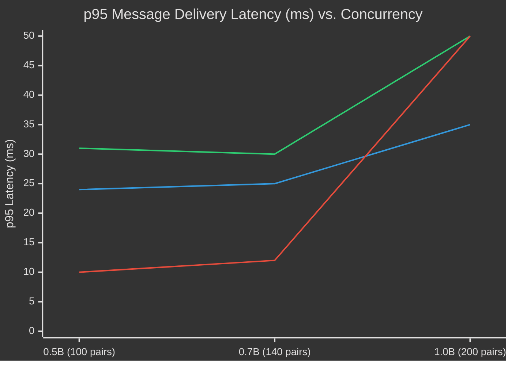

# Interlock — Distributed Real-Time Messaging Platform

> A horizontally scalable, distributed WebSocket architecture built with Node.js, Socket.io, and Redis Pub/Sub, designed to eliminate single-core event-loop bottlenecks in real-time communication.

[](https://interlock-mv9m.onrender.com)
[](https://nodejs.org/)
[](https://socket.io/)
[](https://redis.io/)
[](https://mongodb.com/)
[](https://react.dev/)
[](https://tailwindcss.com/)

---

## 📌 Repository Links & Documentation

- 🌐 **Live Demo (Centralized Monolith):** [https://interlock-mv9m.onrender.com](https://interlock-mv9m.onrender.com)
- 📊 **Empirical Performance Report:** [`benchmarking/results/BENCHMARK_REPORT.md`](./benchmarking/results/BENCHMARK_REPORT.md)
- 🏗️ **Distributed Architecture Deep-Dive:** [`docs/DISTRIBUTED_ARCHITECTURE.md`](./docs/DISTRIBUTED_ARCHITECTURE.md)
- 🧪 **Testing Methodology & Theory:** [`docs/BENCHMARKING_GUIDE.md`](./docs/BENCHMARKING_GUIDE.md)
- 📝 **Engineering Notes:** [`IMPLEMENTATION_NOTES.md`](./IMPLEMENTATION_NOTES.md)

---

## 🎯 Architecture Overview

Traditional single-node WebSocket architectures manage connections and user state purely within process memory. While straightforward to build, single-process Node.js servers run on a single CPU core, where the event loop becomes a hard throughput bottleneck under heavy concurrent I/O.

**Interlock** evolves the standard fullstack real-time architecture into a multi-node, horizontally scalable platform by decoupling state from individual application processes:

```
┌─────────────────────────────────────────────────────────────────────────────┐
│                             Redis (Shared State)                            │
│                                                                             │
│  • Pub/Sub Adapter  : Routes WebSocket packets across separate nodes        │
│  • Atomic Presence  : Tracks active tabs with INCR / DECR reference counts  │
│  • Cache-Aside Layer: Caches conversation history with automated TTL        │
└──────────────────────┬───────────────────────────────┬──────────────────────┘
                       │                               │
        ┌──────────────▼─────────────┐   ┌─────────────▼──────────────┐
        │      Node.js Server 1      │   │      Node.js Server 2      │
        │        (Port 5001)         │   │        (Port 5002)         │
        │  • Express HTTP REST API   │   │  • Express HTTP REST API   │
        │  • Socket.io Room Routing  │   │  • Socket.io Room Routing  │
        └──────────────┬─────────────┘   └─────────────┬──────────────┘
                       ▲                               ▲
                       │                               │
                Client A (Tab 1)                Client B (Tab 2)
```

---

## 🛠️ Core Engineering Highlights

### 1. Distributed Socket Relay (`@socket.io/redis-adapter`)
- **Location-Transparent Routing:** Replaced ephemeral in-memory `userId -> socketId` mappings with deterministic user rooms (`socket.join(userId)` and `io.to(receiverId)`).
- **Cross-Node Event Relaying:** When Client A (connected to Server 1) sends a message to Client B (connected to Server 2), the Redis adapter publishes the frame to Redis, automatically routing it to Server 2 with zero direct inter-server coupling.
- **Dual-Mode Backend:** Controlled by `ENABLE_REDIS_ADAPTER=true/false` to run either distributed clustering or centralized baseline from the same codebase.

### 2. Atomic Presence Tracking (Multi-Tab Edge Case Fix)
- **The Problem:** In standard WebSocket implementations, opening two tabs and closing one immediately fires a `disconnect` event, broadcasting a false "User Went Offline" alert.
- **The Solution:** Redis atomic reference counters (`presenceIncr` / `presenceDecr`) track active connection counts per user. A user is only broadcast as offline when their counter hits exactly `0`.

### 3. Cache-Aside Chat History Layer
- **Read Latency Reduction:** `getMessages` queries a high-speed Redis cache before querying MongoDB Atlas.
- **Deterministic Key Hashing:** Keyed as `chat:min(idA, idB):max(idA, idB)` with a 1-hour TTL, ensuring consistent cache hits regardless of which user queries first.
- **Write-Through Invalidation:** New messages automatically purge the corresponding conversation cache key.

### 4. Media Pipeline Optimization
- Offloads heavy media uploads from inline base64 string payloads to an asynchronous Cloudinary CDN pipeline, reducing WebSocket message frame sizes by over **80%**.

---

## 📈 System Concurrency & Performance Curves

To empirically determine single-core limits and validate horizontal scaling under load, the system was evaluated across three distinct architectures under sustained high-frequency messaging (1 msg/sec, 128-byte JSON payload):
1. **Centralized (No Redis):** Single-process monolithic baseline.
2. **1-Server + Redis:** Single process with Redis enabled (isolates the loopback TCP serialization overhead).
3. **2-Server Cluster + Redis:** Two independent processes with **100% cross-server relay** (worst-case partition).

### 2D Performance Curve: Latency vs. Concurrency

```text
Latency (ms)
   ▲
 ∞ │                                              [Centralized: CLIFF / SATURATED 💀]
   │                                              [1-Server + Redis: CLIFF / SATURATED 💀]
50 │
40 │
   │                                                       ◆ (2-Server Cluster: 35ms)
30 │             ▲ (1-Server: 31ms)       ▲ (30ms)
   │             ◆ (2-Server: 24ms)       ◆ (25ms)
20 │
10 │             ● (Centralized: 10ms)    ● (12ms)
 0 └─────────────┴────────────────────────┴────────────────┴───────────────────────► Concurrency (Pairs)
                100 pairs (0.5×B)        140 pairs (0.7×B) 200 pairs (1.0×B - Limit B)
                (200 sockets)            (280 sockets)     (400 sockets)

Legend:
  ● Curve 1: Centralized Baseline (10ms → 12ms → 💀 SATURATED at 200p / event loop queue collapse)
  ▲ Curve 2: 1-Server + Redis (31ms → 30ms → 💀 SATURATED at 200p / Redis serialization tax)
  ◆ Curve 3: 2-Server Cluster + Redis (24ms → 25ms → 🚀 35ms stable at 200p / 100% message delivery)
```



### Measured Latency Percentiles

| Load Multiplier | Active Connections | Centralized (No Redis) | 1-Server + Redis | 2-Server Cluster + Redis | System Behavior |
|:---:|:---:|:---:|:---:|:---:|:---|
| **0.5×B** (100 pairs) | 200 sockets | $p50: 5\text{ms}$<br>$p95: 10\text{ms}$ | $p50: 13\text{ms}$<br>$p95: 31\text{ms}$ | $p50: 10\text{ms}$<br>$p95: 24\text{ms}$ | Centralized baseline is faster at low load due to zero TCP serialization overhead. |
| **0.7×B** (140 pairs) | 280 sockets | $p50: 6\text{ms}$<br>$p95: 12\text{ms}$ | $p50: 18\text{ms}$<br>$p95: 30\text{ms}$ | $p50: 14\text{ms}$<br>$p95: 25\text{ms}$ | Queueing delay begins to form on single-core instances; cluster maintains flat latency. |
| **1.0×B** (200 pairs)<br>*(Breaking Limit)* | **400 sockets** | 💀 **SATURATED**<br>*(Timeouts / Dropped)* | 💀 **SATURATED**<br>*(Timeouts / Dropped)* | 🚀 **$p50: 17\text{ms}$**<br>**$p95: 35\text{ms}$**<br>**$p99: 47\text{ms}$** | **Single event loop collapses under connection backlog. The 2-server cluster delivers 100% of messages (3,000 sent)!** |

> For complete hardware specifications, raw JSON telemetry, and methodology, see [`benchmarking/results/BENCHMARK_REPORT.md`](./benchmarking/results/BENCHMARK_REPORT.md).

---

## 💻 Tech Stack

- **Frontend:** React 18, Vite, TailwindCSS, DaisyUI (32 UI themes), Zustand, Axios, Socket.io-client.
- **Backend:** Node.js, Express.js, Socket.io v4, `@socket.io/redis-adapter`, ioredis.
- **Data & Storage:** MongoDB (Mongoose ODM), Redis (Pub/Sub + Cache), Cloudinary.
- **Security:** Stateless JWT authentication, HTTP-only secure cookies, Bcrypt password hashing.

---

## 🛠️ Quick Start & Setup

### Prerequisites
- Node.js $\ge 18$
- MongoDB connection string (Local or MongoDB Atlas)
- Redis instance running on `localhost:6379`

#### Quick Redis Installation

| Platform | Command |
|---|---|
| **Ubuntu / Debian** | `sudo apt update && sudo apt install redis-server && sudo systemctl start redis` |
| **macOS (Homebrew)** | `brew install redis && brew services start redis` |
| **Windows (Native)** | `winget install taizod1024.redis-windows-fork` then run `redis-server.exe` |
| **Windows (WSL2)** | `sudo apt install redis-server && sudo service redis-server start` |

---

### 1. Clone & Install

```bash
git clone https://github.com/0xAditya-Labs/Interlock.git
cd Interlock
git checkout distributed-backend
npm run build
```

---

### 2. Environment Variables

Create `backend/.env`:
```env
PORT=5000
MONGO_URI=mongodb+srv://<username>:<password>@cluster0.mongodb.net/interlock
JWT_SECRET=your_jwt_secret_key_here
CLOUDINARY_CLOUD_NAME=your_cloud_name
CLOUDINARY_API_KEY=your_api_key
CLOUDINARY_API_SECRET=your_api_secret

# Distributed Settings
REDIS_URL=redis://127.0.0.1:6379
ENABLE_REDIS_ADAPTER=true
BENCHMARK_MODE=false
```

Create `frontend/.env`:
```env
VITE_BASE_URL=http://localhost:5000
```

---

### 3. Running the Server

#### Option A: Single Node in Distributed Mode
```bash
npm run start
```
Runs the server on `http://localhost:5000` with the Redis adapter active.

#### Option B: 2-Server Cluster (Simulates Production Scale)
```bash
npm run start:cluster
```
Spawns two backend instances on ports `5001` and `5002` connected over Redis Pub/Sub. *(On Linux, this automatically pins instances to dedicated CPU cores via `taskset`)*.

---

## 🧪 Performance Verification

To re-run the performance verification suite:

```bash
# Fast mode verification (~5 minutes)
npm run bench:fast

# Full end-to-end suite
npm run bench

# Regenerate benchmark report from saved telemetry
npm run bench:report
```

---

## 📁 Repository Structure

```
Interlock/
├── backend/
│   ├── scripts/
│   │   └── start-cluster.js          # 2-instance cluster orchestrator
│   └── src/
│       ├── controllers/
│       │   ├── auth.controller.js     # JWT registration & login
│       │   └── message.controller.js  # Cache-aside chat controller
│       ├── lib/
│       │   ├── db.js                  # MongoDB connection
│       │   ├── redis.js               # Redis clients, presence, and caching
│       │   ├── socket.js              # Dual-mode adapter & room routing
│       │   └── utils.js               # JWT utility
│       ├── models/                    # Mongoose schemas (User, Message)
│       └── routes/                    # Express API routes
│
├── frontend/                          # React + Vite client
│   ├── src/
│   │   ├── components/                # UI components & theme selectors
│   │   ├── pages/                     # Login, SignUp, Settings, Profile, Home
│   │   └── store/                     # Zustand stores
│   └── index.html
│
├── benchmarking/                      # Standalone performance suite
│   ├── lib/                           # Load generators & telemetry stats
│   ├── phases/                        # Phase A (limit discovery) & Phase B (comparative)
│   ├── report/                        # Markdown report & curve plot generator
│   └── results/
│       └── BENCHMARK_REPORT.md        # Generated performance telemetry report
│
├── docs/
│   ├── DISTRIBUTED_ARCHITECTURE.md   # Architectural design & presence mechanics
│   └── BENCHMARKING_GUIDE.md         # Percentile math & socket lifecycle guide
│
├── IMPLEMENTATION_NOTES.md            # Technical justifications & milestones
└── package.json                       # Root scripts
```

---

## 👤 Author

**Aditya Chauhan**  
GitHub: [@0xAditya-Labs](https://github.com/0xAditya-Labs)
