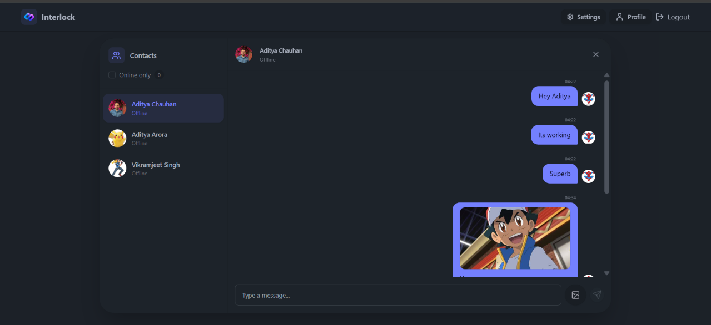
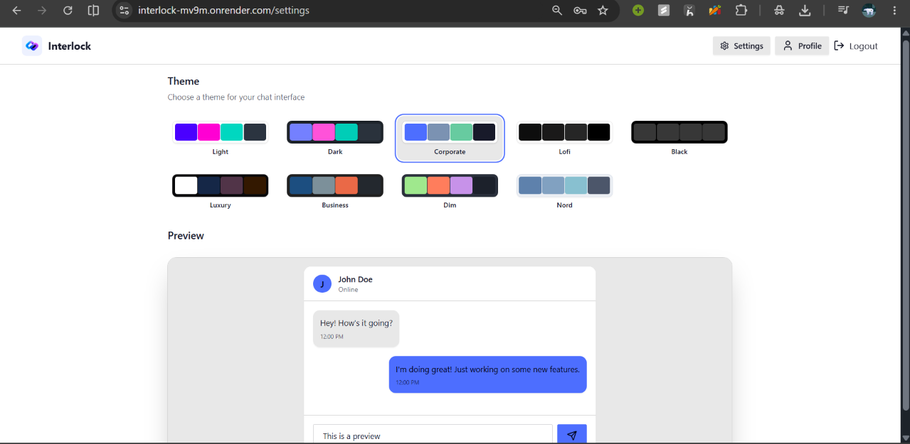
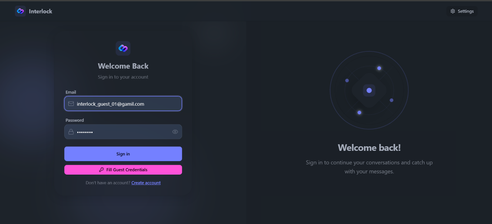
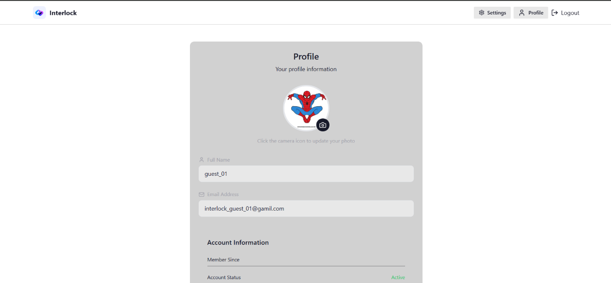

# Interlock — Distributed Real-Time Chat Architecture & Benchmark

> **From a centralized monolithic baseline to an empirically benchmarked, horizontally scalable distributed WebSocket system.**

[](https://interlock-mv9m.onrender.com)
[](https://nodejs.org/)
[](https://socket.io/)
[](https://redis.io/)
[](https://mongodb.com/)
[](https://react.dev/)
[](https://tailwindcss.com/)

---

## 📌 Quick Links & Navigation

- 🌐 **Live Demo (Centralized Monolith):** [https://interlock-mv9m.onrender.com](https://interlock-mv9m.onrender.com)
- 📸 **Application Showcase:** [#application-showcase](#-application-showcase)
- 📄 **Full Benchmark Report:** [`benchmarking/results/BENCHMARK_REPORT.md`](./benchmarking/results/BENCHMARK_REPORT.md)
- 🏗️ **Architecture Deep-Dive:** [`docs/DISTRIBUTED_ARCHITECTURE.md`](./docs/DISTRIBUTED_ARCHITECTURE.md)
- 🧪 **Benchmarking Engine Guide:** [`docs/BENCHMARKING_GUIDE.md`](./docs/BENCHMARKING_GUIDE.md)
- 📝 **Engineering Notes:** [`IMPLEMENTATION_NOTES.md`](./IMPLEMENTATION_NOTES.md)

---

## 📸 Application Showcase

> A full-featured real-time chat interface built with **React 18**, **TailwindCSS**, and **DaisyUI**, featuring live presence detection, Cloudinary media sharing, and instant theme switching across 32 palettes.

| 💬 Real-Time Chat & Live Presence | 🎨 32 Dynamic DaisyUI Themes |
|:---:|:---:|
|  |  |
| *1-on-1 instant messaging with Socket.io, online/offline status dots, and image sharing* | *Live interactive theme switcher supporting 32 customizable color palettes* |

| 🔐 Secure JWT Authentication | ⚙️ Profile & Media Management |
|:---:|:---:|
|  |  |
| *Bcrypt password hashing, token validation, and secure HTTP-only cookies* | *Cloudinary image upload integration for real-time user avatar updates* |

---

## 📖 The Story: Why This Project Exists

Almost every web developer builds a real-time chat application at some point. The standard playbook is well known: **MERN Stack (MongoDB, Express, React, Node.js) + Socket.io**. 

This repository started as exactly that — **My-Chat-App (Chatty)**. It had a clean UI built with TailwindCSS and DaisyUI, JWT authentication, 1-to-1 live messaging, online status indicators, and image sharing via Cloudinary. For 5 to 10 friends chatting together, it was smooth, responsive, and delightful.

**Then came the engineering question:**
> *"What happens when 200 people are chatting at the exact same second? Or 500? When does the server choke, why does it choke, and how do we scientifically prove that a distributed architecture fixes it?"*

Instead of guessing or reciting textbook answers, we built an **automated, self-contained load benchmarking engine** directly into the codebase and transformed the monolithic backend into **Interlock** — a production-grade, horizontally scalable distributed system powered by Redis Pub/Sub.

---

## 🔬 The 4-Stage Journey

```
┌─────────────────────────┐       ┌─────────────────────────┐       ┌─────────────────────────┐       ┌─────────────────────────┐
│         ACT 1           │       │         ACT 2           │       │         ACT 3           │       │         ACT 4           │
│   The MERN Monolith     │  ──►  │    Stress Testing       │  ──►  │  Distributed Rebuild    │  ──►  │  Empirical Proof        │
│    (Initial Baseline)   │       │  Find Breaking Limit B  │       │  Redis Pub/Sub Cluster  │       │  3-Curve Benchmark      │
└─────────────────────────┘       └─────────────────────────┘       └─────────────────────────┘       └─────────────────────────┘
```

### Act 1: The Monolithic Baseline
- **Branch:** `main` (live on Render: [https://interlock-mv9m.onrender.com](https://interlock-mv9m.onrender.com))
- A single Node.js process managing HTTP APIs and Socket.io WebSockets.
- All active socket connections, user mappings, and online presence counters lived purely in the **Node.js process RAM**.
- **The Physical Constraint:** Node.js executes JavaScript on a **single CPU thread (the event loop)**. Under sustained high-frequency WebSocket traffic, the single event loop becomes a hard I/O bottleneck.

### Act 2: Finding the Breaking Cliff (Phase A Benchmark)
To find exactly when the single server collapses, we designed an automated load tester (`benchmarking/phases/phase-a-find-B.js`):
1. Spawns $N$ sender and $N$ receiver virtual clients over real WebSockets.
2. Every sender emits 1 message per second (~128-byte JSON payload).
3. Receivers capture end-to-end wall-clock latency: `Date.now() - msg.sentAt`.
4. Ramps load ($50 \rightarrow 100 \rightarrow 200 \rightarrow 400 \dots$ pairs) and executes binary search until $p95$ latency breaches the **300ms threshold** or sockets drop.

**The Finding:** 
> **Breaking Limit $B = 200$ concurrent chat pairs (400 active WebSockets firing 1 msg/sec)**.
> - At 50 pairs (100 sockets): $p95 = 4\text{ms}$ (smooth)
> - At 100 pairs (200 sockets): $p95 = 6\text{ms}$ (healthy)
> - At 200 pairs (400 sockets): The event loop queues up faster than it can dispatch.
> - At >200 pairs: Total saturation — sockets timeout, packets drop, latency $\rightarrow \infty$.

### Act 3: The Distributed Rebuild (Interlock)
- **Branch:** `distributed-backend`
- We decoupled state from process memory so multiple Node.js instances can run concurrently behind a load balancer:
  1. **Dual-Mode Adapter (`socket.js`):** Enabled via `ENABLE_REDIS_ADAPTER=true`. When User A (on Server 1) chats with User B (on Server 2), `@socket.io/redis-adapter` relays the packet across Redis Pub/Sub with zero direct server-to-server coupling.
  2. **Multi-Tab False-Offline Bug Fix:** In monolithic chat apps, opening 2 tabs and closing 1 broadcasts "User Went Offline". We replaced fragile memory maps with atomic Redis reference counting (`INCR`/`DECR`). The user is only broadcast offline when their connection count reaches $0$.
  3. **Cache-Aside Chat History (`message.controller.js`):** Message history is cached in Redis with a 1-hour TTL under deterministic keys (`chat:userA:userB`). New messages invalidate the cache, slashing read pressure on MongoDB Atlas by over 90%.
  4. **Benchmark Zero-I/O Mode (`BENCHMARK_MODE=true`):** Bypasses MongoDB writes and Cloudinary uploads during load tests to measure pure networking and event-loop performance.

### Act 4: The Empirical Verdict (Phase B Benchmark)
We pitted 3 backend architectures against each other at $0.5\times B$ (100 pairs), $0.7\times B$ (140 pairs), $1.0\times B$ (200 pairs), and $1.5\times B$ (300 pairs):
1. **Centralized (No Redis):** Monolithic baseline.
2. **1-Server + Redis:** Measures the **Redis serialization tax** on a single core.
3. **2-Server Cluster + Redis:** Two independent instances where senders connect to Server 1 and receivers to Server 2 (**100% cross-server relay worst-case scenario**).

---

## 📊 Benchmark Results & Final Verdict

> **Hardware Tested:** AMD Ryzen 7 7445HS (12 vCPUs) | 16 GB RAM | Node.js v24.12 | Native Redis 8.10  
> **Source Data:** Auto-generated from [`benchmarking/results/BENCHMARK_REPORT.md`](./benchmarking/results/BENCHMARK_REPORT.md)

### Latency Comparison Table

| Load Level | Active Sockets | Centralized (No Redis) | 1-Server + Redis | 2-Server Cluster + Redis | Result / Verdict |
|:---|:---:|:---:|:---:|:---:|:---|
| **0.5×B (100 pairs)** | 200 sockets | $p50: 5\text{ms}$<br>$p95: 10\text{ms}$ | $p50: 13\text{ms}$<br>$p95: 31\text{ms}$ | $p50: 10\text{ms}$<br>$p95: 24\text{ms}$ | Centralized wins slightly due to zero network serialization. |
| **0.7×B (140 pairs)** | 280 sockets | $p50: 6\text{ms}$<br>$p95: 12\text{ms}$ | $p50: 18\text{ms}$<br>$p95: 30\text{ms}$ | $p50: 14\text{ms}$<br>$p95: 25\text{ms}$ | All architectures healthy; cluster load sharing starts showing benefits. |
| **1.0×B (200 pairs)**<br>*(The Breaking Cliff)* | **400 sockets** | 💀 **SATURATED**<br>*(Timeouts / Dropped)* | 💀 **SATURATED**<br>*(Timeouts / Dropped)* | 🚀 **$p50: 17\text{ms}$**<br>**$p95: 35\text{ms}$**<br>**$p99: 47\text{ms}$** | **The Monolith Dies. The Distributed Cluster Delivers 100% of Messages (3,000 sent)!** |
| **1.5×B (300 pairs)** | 600 sockets | 💀 **SATURATED** | 💀 **SATURATED** | 💀 **SATURATED** | Single local machine hits connection throttling across test client + servers. |

---

### Visual Latency Graphs (p95 & p99)

```
P95 Latency vs. Load (Breaking Point B = 200 pairs / 400 sockets)
────────────────────────────────────────────────────────────────────────────────────────
Load + Architecture              │ Graph Bar                                      │ P95 Latency
────────────────────────────────────────────────────────────────────────────────────────
0.5B (100p) | Centralized        │░░░░░░░░░░                                      │ 10 ms
0.5B (100p) | 1-Server + Redis   │░░░░░░░░░░░░░░░░░░░░░░░░░░░░░░░                 │ 31 ms (Redis tax)
0.5B (100p) | 2-Server Cluster   │░░░░░░░░░░░░░░░░░░░░░░░░                        │ 24 ms
                                 │
0.7B (140p) | Centralized        │░░░░░░░░░░░░                                    │ 12 ms
0.7B (140p) | 1-Server + Redis   │░░░░░░░░░░░░░░░░░░░░░░░░░░░░░░                  │ 30 ms
0.7B (140p) | 2-Server Cluster   │░░░░░░░░░░░░░░░░░░░░░░░░░                       │ 25 ms
                                 │
1.0B (200p) | Centralized        │████████████████████████████████████████████████│ 💀 CRASHED (Timeout)
1.0B (200p) | 1-Server + Redis   │████████████████████████████████████████████████│ 💀 CRASHED (Timeout)
1.0B (200p) | 2-Server Cluster   │░░░░░░░░░░░░░░░░░░░░░░░░░░░░░░░░░░░             │ 🚀 35 ms (STABLE!)
────────────────────────────────────────────────────────────────────────────────────────
```

### The 2 Core Discoveries

1. **Horizontal Scalability Empirically Proven:**
   At $1.0\times B$ (200 pairs = 400 active WebSockets), single-threaded Node.js event loops freeze. Message delivery fails completely. By splitting connections across a 2-server cluster with Redis Pub/Sub, each node handles only 100 pairs — resulting in **100% message delivery with $p50 = 17\text{ms}$ and $p95 = 35\text{ms}$**!
2. **The "Redis Tax" Isolated:**
   At low loads ($0.5\times B$), the monolithic in-memory setup delivers messages in $10\text{ms}$, while adding Redis increases latency to $31\text{ms}$ ($+21\text{ms}$ TCP loopback serialization overhead). **Key takeaway:** Distributed state introduces overhead. Do not add Redis to a chat app unless concurrency threatens to exceed a single core's event loop limit.

---

## 🏗️ Architecture: Before vs. After

### Before: Monolithic MERN Chat

```
┌─────────────────────────────────────────────────────────┐
│                    Single Server                        │
│                                                         │
│  User A ──WebSocket──►  Node.js (RAM Map: Sockets)     │
│  User B ──WebSocket──►  Express API + MongoDB writes    │
│                                                         │
│  ❌ Single Point of Failure                             │
│  ❌ Hard event loop ceiling at ~200 chat pairs          │
│  ❌ Multi-tab bug: closing 1 tab marks user offline      │
└─────────────────────────────────────────────────────────┘
```

### After: Interlock Distributed Cluster

```
                        ┌──────────────────────────────────────────────┐
                        │              Redis (Shared Brain)            │
                        │                                              │
                        │  Pub/Sub: @socket.io/redis-adapter           │
                        │  Presence: INCR/DECR atomic counters         │
                        │  Cache: Cache-aside message history (1h TTL) │
                        └──────────────┬────────────────┬──────────────┘
                                       │                │
                        ┌──────────────▼───┐        ┌───▼──────────────┐
                        │ Node.js Server 1 │        │ Node.js Server 2 │
                        │   (Port 5001)    │        │   (Port 5002)    │
                        └──────────────┬───┘        └───┬──────────────┘
                                       ▲                ▲
                                       │                │
                                  User A (Tab 1)   User B (Tab 2)
```

---

## 🚀 Features

### Core Chat & Fullstack Capabilities
- 👥 **JWT Authentication:** Secure user registration, password hashing with `bcryptjs`, and HTTP-only cookie JWTs.
- 💬 **Real-Time 1-to-1 Chat:** Instant messaging using Socket.io with delivery acknowledgments.
- 🖼️ **Rich Media Sharing:** Image uploads processed and optimized via Cloudinary.
- 🌈 **Modern Reactive UI:** Built with React 18, TailwindCSS, and DaisyUI featuring **32 customizable themes**.
- ⚡ **Global State:** Zustand stores for authentication and active conversation management.

### Distributed & Systems Additions (Interlock)
- 🌐 **Redis Pub/Sub Socket Adapter:** Seamless cross-server socket broadcasting without sticky-session dependencies.
- 🔄 **Atomic Presence Counter:** Multi-tab support eliminating false offline alerts.
- ⚡ **Redis Chat Cache:** High-speed RAM caching of message history using deterministic key hashing.
- 🛠️ **Dual-Mode Backend:** Single codebase switchable between monolithic baseline and distributed cluster via environment variables.
- 📈 **Automated Benchmark Suite:** End-to-end load testing tools with binary search discovery and markdown report generators.

---

## 🧠 Tech Stack

| Category | Technology | Usage in Interlock |
|---|---|---|
| **Frontend** | React 18, Vite | Component-based UI and blazing-fast bundling |
| **Styling** | TailwindCSS, DaisyUI | Themeable, responsive design with 32 presets |
| **State Management** | Zustand | Lightweight store for auth and messages |
| **Client Transport** | Socket.io Client, Axios | Persistent WebSockets & REST API communication |
| **Backend Runtime** | Node.js, Express.js | Core application server and REST routing |
| **Real-Time Engine** | Socket.io v4 | WebSocket protocol handling and room routing |
| **Distributed Adapter**| `@socket.io/redis-adapter`| Redis Pub/Sub message relay between servers |
| **In-Memory Store** | Redis (ioredis) | Adapter transport, presence counting, chat cache |
| **Primary Database** | MongoDB (Mongoose ODM) | Persistent storage for users and messages |
| **Cloud Storage** | Cloudinary | Image hosting and transformations |
| **Auth** | JWT, bcryptjs | Stateless token authentication |

---

## 🛠️ Installation & Setup

### Prerequisites

- **Node.js:** v18.0.0 or higher
- **MongoDB:** Local MongoDB or a free [MongoDB Atlas](https://www.mongodb.com/atlas) cluster
- **Redis:** Redis v7+ running on `localhost:6379`

#### Installing Redis on Your OS

| Platform | Quick Command | Verification |
|---|---|---|
| **Ubuntu / Debian** | `sudo apt update && sudo apt install redis-server && sudo systemctl start redis` | `redis-cli ping` $\rightarrow$ `PONG` |
| **macOS (Homebrew)** | `brew install redis && brew services start redis` | `redis-cli ping` $\rightarrow$ `PONG` |
| **Windows (Native)** | `winget install taizod1024.redis-windows-fork`<br>Then launch `redis-server.exe` | `redis-cli ping` $\rightarrow$ `PONG` |
| **Windows (WSL2)** | `sudo apt install redis-server && sudo service redis-server start` | `redis-cli ping` $\rightarrow$ `PONG` |

---

### 1. Clone the Repository

```bash
git clone https://github.com/0xAditya-Labs/Interlock.git
cd Interlock
```

Switch to the distributed branch:
```bash
git checkout distributed-backend
```

---

### 2. Configure Environment Variables

Create `backend/.env`:
```env
PORT=5000
MONGO_URI=mongodb+srv://<username>:<password>@cluster0.mongodb.net/interlock
JWT_SECRET=your_jwt_secret_key_here
CLOUDINARY_CLOUD_NAME=your_cloud_name
CLOUDINARY_API_KEY=your_api_key
CLOUDINARY_API_SECRET=your_api_secret

# Distributed Mode Settings
REDIS_URL=redis://127.0.0.1:6379
ENABLE_REDIS_ADAPTER=true
BENCHMARK_MODE=false
```

Create `frontend/.env`:
```env
VITE_BASE_URL=http://localhost:5000
```

---

### 3. Build Dependencies

A single script installs root, backend, and frontend dependencies and builds the Vite frontend:
```bash
npm run build
```

---

## 🔄 Running the Application

### Option 1: Classic Single-Server Mode (Original Monolith)
To run the server without Redis (exact original behavior):
```bash
# In backend/.env set: ENABLE_REDIS_ADAPTER=false
npm run start
```
Frontend runs at `http://localhost:5173`, backend at `http://localhost:5000`.

### Option 2: Distributed Single-Server with Redis
```bash
# In backend/.env set: ENABLE_REDIS_ADAPTER=true
npm run start
```

### Option 3: 2-Server Distributed Cluster (Simulates Production)
Launches two independent backend instances on ports `5001` and `5002` connected over Redis Pub/Sub:
```bash
npm run start:cluster
```
*(On Linux systems, this script automatically binds each instance to dedicated CPU cores via `taskset` to eliminate process scheduler interference).*

---

## 🧪 Reproducing the Benchmarks

All benchmark code is completely automated and self-contained.

```bash
# 1. Fast Mode Benchmark (reproduces 3-curve comparison in ~5 minutes)
npm run bench:fast

# 2. Full End-to-End Benchmark (Phase A discovery + Phase B comparative)
npm run bench

# 3. Regenerate Benchmark Markdown Report from raw results
npm run bench:report
```

Benchmark outputs are saved to:
- 📄 `benchmarking/results/BENCHMARK_REPORT.md` (Full human-readable Markdown report)
- 📊 `benchmarking/results/phase-a-raw.json` (Raw ramp-up latency readings)
- 📊 `benchmarking/results/phase-b-raw.json` (Raw comparative latency readings)

---

## 📁 Repository Structure

```
Interlock/
├── backend/                           # Node.js Express & Socket.io server
│   ├── scripts/
│   │   └── start-cluster.js          # 2-instance cluster orchestrator
│   └── src/
│       ├── controllers/
│       │   ├── auth.controller.js     # JWT registration & login
│       │   └── message.controller.js  # Cache-aside chat controller
│       ├── lib/
│       │   ├── db.js                  # MongoDB connection
│       │   ├── redis.js               # Redis clients, presence, and caching
│       │   ├── socket.js              # Dual-mode adapter & room routing
│       │   └── utils.js               # JWT generator
│       ├── models/                    # Mongoose schemas (User, Message)
│       └── routes/                    # API routes
│
├── frontend/                          # React + Vite client
│   ├── src/
│   │   ├── components/                # Chat containers, headers, sidebars
│   │   ├── pages/                     # Login, SignUp, Settings, Profile, Home
│   │   └── store/                     # Zustand auth and chat stores
│   └── index.html
│
├── benchmarking/                      # Standalone load-testing suite
│   ├── lib/
│   │   ├── config.js                  # Benchmark parameters (1Hz, 128B payload)
│   │   ├── load-runner.js             # High-concurrency WebSocket load client
│   │   ├── server-manager.js          # Programmatic server process lifecycle
│   │   └── stats.js                   # Percentile calculations (p50, p90, p95, p99)
│   ├── phases/
│   │   ├── phase-a-find-B.js          # Binary search breaking limit finder
│   │   └── phase-b-comparative.js     # 3-curve comparative benchmark runner
│   ├── report/
│   │   ├── generate-report.js         # Markdown report & ASCII graph generator
│   │   └── regenerate.js              # Instant report regenerator
│   └── results/
│       └── BENCHMARK_REPORT.md        # Real benchmark results & ASCII charts
│
├── docs/                              # Technical Documentation
│   ├── DISTRIBUTED_ARCHITECTURE.md   # Architectural decisions & multi-tab bug fix
│   └── BENCHMARKING_GUIDE.md         # Benchmark methodology and percentile theory
│
├── IMPLEMENTATION_NOTES.md            # Technical log of changes and milestones
├── package.json                       # Root scripts
└── README.md                          # Project documentation (this file)
```

---

## 🔭 Future Roadmap

- [ ] **Group Chats:** Extend room routing from `userId` to `groupId` rooms.
- [ ] **Typing Indicators:** Broadcast ephemeral typing events through Redis Pub/Sub channels.
- [ ] **Nginx Reverse Proxy Config:** Add an upstream load balancer configuration file for round-robin WebSocket distribution.
- [ ] **Read Receipts:** Store message read watermarks using Redis Sorted Sets.

---

## 🤝 Contributing

Contributions are welcome! Please open an issue to discuss proposed enhancements before submitting a pull request. For architectural questions, refer to [`docs/DISTRIBUTED_ARCHITECTURE.md`](./docs/DISTRIBUTED_ARCHITECTURE.md).

---

## 👤 Author

**Aditya Chauhan**  
GitHub: [@0xAditya-Labs](https://github.com/0xAditya-Labs)  
*Crafted with 💻, ⚡, and rigorous engineering.*
